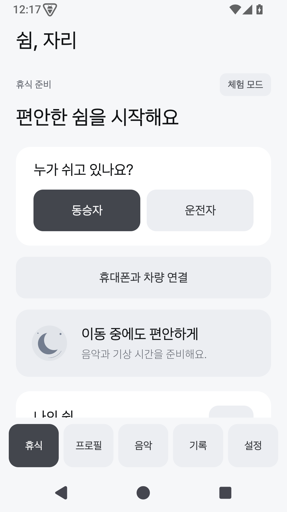
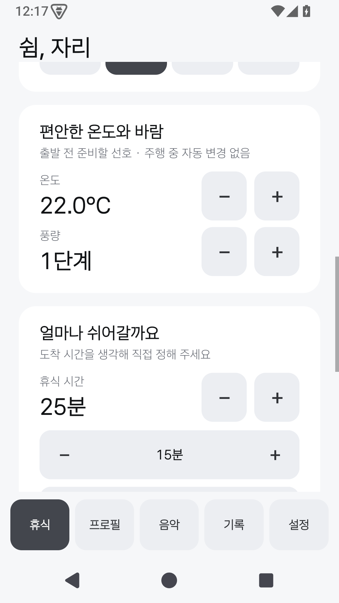

# 쉼, 자리

주행 중 동승자가 편안히 쉬는 흐름과 주차 후 운전자가 쉬는 흐름을 구분하는 Pleos Connect Android 앱입니다. 날씨·시간·사용자가 선택한 기분에 맞는 음악과 개인별 선호를 연결합니다. 현재 버전은 **1.3.1**입니다.

| 모드 | 사용할 사람과 상황 | 음악과 화면 | 차량 환경 |
| --- | --- | --- | --- |
| 동승자 휴식 | 동승석·뒷좌석에서 이동 중 휴식 | 다른 앱·화면 꺼짐 중에도 사용자가 시작한 음악을 재생, 조용한 종료 알림 | 출발 전 공조 준비 가능, 주행 중 자동 공조·좌석 변경 없음 |
| 운전자 휴식 | P단으로 주차한 뒤 운전자 휴식 | 어두운 휴식 화면과 기상 알림, 앱 이탈 시 음악 중지 | 정차·지원 확인 후 온도·풍량 적용과 종료 후 복원 요청 |

상세한 모드 차이는 [모드 설계](docs/MODES.md), 도착 전 기상·실제 LAN 페어링·다중 동승자는 [휴대폰 연결 안내](docs/COMPANION.md)에 정리했습니다.





1.3.1을 Android 휴대폰 에뮬레이터에서 실행한 화면입니다. 다크 모드와 가로 배치는 [화면 구성](docs/UI.md)에 정리했습니다. 공조 값은 체험 값이며 실제 차량 제어 성공을 나타내지 않습니다.

## 제출용 실행 및 테스트 환경

- 제출 APK: `apk/최주영_쉼, 자리_release.apk` (서명된 release, 버전 1.3.1 / versionCode 5).
- Pleos Connect Emulator **2.1.0**, x86_64, Android 14(API 34), **2560 × 1440 / 160dpi**. 앱 창 **1682 × 1210**에서도 확인했습니다.
- 휴대폰 검증: AOSP Android 15(API 35) x86_64, **1080 × 1920 / 420dpi**. 작은 화면·큰 글꼴 및 가로 배치도 확인했습니다.
- 기상 테스트에는 알림 권한이 필요하며 정확한 알람 권한을 허용하면 절전 중 정확한 예약에 사용합니다. 알림·방해 금지·배터리 설정에 따라 실제 전달이 달라질 수 있습니다.
- 음악·예보는 인터넷이 필요합니다. 차량·휴대폰 연결은 서로 통신할 수 있는 같은 Wi-Fi/핫스폿과 인증 코드 확인·차량 승인이 필요합니다.
- 처음에는 체험 모드로 열립니다. 실제 공조 쓰기·복원과 활성 내비게이션 ETA 수신, 실차에서의 두 기기 연속 시험은 미검증입니다. 자세한 범위는 [검증 기록](docs/VERIFICATION.md)을 따릅니다.

공식 참가 가이드·공지·FAQ와의 대조 결과는 [제출 기준 점검](docs/CONTEST_CHECK.md)에 기록했습니다. 공모전 심사와 Pleos App Market 입점 심사는 별개이며, 2차는 Pleos Connect 에뮬레이터에서 시연합니다. 실제 차량은 필수가 아닙니다.

설치 명령 예시:

```sh
adb install -r "apk/최주영_쉼, 자리_release.apk"
```

## 실행

1. [제출 APK](<apk/최주영_쉼, 자리_release.apk>)를 Android 9(API 28) 이상 기기 또는 Pleos Connect 에뮬레이터에 설치합니다.
2. 처음에는 **체험 모드**로 열립니다. 체험 모드의 공조 값은 앱 내부 시뮬레이션이며 실제 차량을 변경하지 않습니다.
3. 프로필의 별명·좌석·온도·풍량·휴식 시간·소리를 선택합니다.
4. `오늘의 음악`에서 휴식 목적·현재 기분·날씨·장르를 고릅니다. `지역을 골라 날씨 가져오기`는 선택한 도시의 모델 예보를 조회합니다. 실패하면 날씨를 직접 선택할 수 있습니다.
5. `오늘의 음악 추천받기`에서 실제 곡과 아티스트·추천 이유를 확인하고 `이 곡부터 휴식 음악으로 선택`을 누릅니다. 음악 서비스는 **Audius**이며 멜론의 음원 목록을 사용하는 기능은 아닙니다.
6. 홈에서 `동승자 휴식` 또는 `운전자 휴식`을 선택합니다. 동승자는 `동승자 휴식 시작 > 음악·타이머 시작`으로 이동 중에도 시작할 수 있습니다. `출발 전 공조도 준비`는 정차 확인 후 지원 항목만 요청합니다. 운전자는 `주차 후 운전자 휴식 시작`에서 주차를 확인합니다. 실제 차량에서 주행 중으로 확인되면 운전자 휴식은 시작되지 않습니다.
7. `휴식 마치기`에서 앱이 변경한 설정의 복원 결과를 확인하고 이번 휴식의 느낌을 기록합니다.
8. Pleos 환경에서는 `설정 > Pleos 차량에 연결`을 선택해 실제 SDK 응답을 확인합니다. 연결 실패를 체험 값으로 대체하지 않습니다.

차량의 공용 공조와 스피커는 다른 탑승자에게도 영향을 줄 수 있습니다. 사용 전에 함께 확인해 주세요. 운전 중인 사람은 휴식 대상이 될 수 없습니다. 동승자 모드 선택으로 운전자 화면 제한을 해제하지 않습니다. 상세 설정은 출발 전 또는 사용이 허용된 승객 화면에서 하고, 차량의 `CarUxRestrictions`가 활성화되면 상세 UI를 숨깁니다. 실차의 주행 화면·차량 미디어 호스트 연동과 앱 마켓 심사는 별도 검증 대상입니다.

## 1.3.1 화면과 조작 개선

- 앱 표시 이름을 **쉼, 자리**로 변경했습니다. 기존 앱 위에 업데이트할 수 있도록 패키지와 서명은 유지합니다.
- Pleos 공식 색상·글꼴 가이드를 참고해 차콜·흰색, Asta Sans, 시스템 다크 모드와 일정한 버튼·간격을 적용했습니다.
- 역할 선택은 `동승자 / 운전자` 두 항목으로 간소화했습니다.
- 휴식 시간 기본 −/+는 1분 단위, 별도 `− 15분 +`와 `− 1시간 +`로 빠르게 조절합니다. 범위는 1~180분입니다.
- 시간·선호·개인 알람 버튼을 눌러 설정이 바뀌어도 현재 화면의 스크롤 위치를 유지합니다.

[화면 구성과 실제 실행 화면](docs/UI.md)

## 1.3 추가 기능

- 차량·동승자 휴대폰의 실제 TLS LAN 연결, 인증 코드 비교·차량 승인
- 좌석·온도·풍량·선택 음악·기상 선호 전송과 음악 대표의 원격 재생 제어
- 직접 입력한 도착 시각과 개인 여유 시간으로 깨우기, 연결이 끊겨도 유지되는 휴대폰 개인 알람
- NaviHelper 3.0.5의 읽기 전용 ETA 어댑터와 수동 도착 시각 대안
- 최대 3명의 좌석 중복 방지·개별 휴식 타이머·공용 풍량과 소리 제안
- 휴식 평가를 바탕으로 다음 온도·소리를 제안하고 확인 후 적용

두 기기의 설치·연결 순서는 [연결 안내](docs/COMPANION.md)를 확인하세요. 서로 통신할 수 있는 같은 네트워크가 필요하며 Wi-Fi 격리·차량 권한 정책에 따라 달라집니다.

## 제공 기능

- 기기 내부 프로필 최대 8개, 별명 변경·선택·삭제
- 모드별 좌석 제한, 기존 프로필·진행 중 세션의 모드 복구
- 동승자 음악의 알림 기반 foreground service와 표준 MediaBrowserService·MediaSession 제어
- 동승자 조용한 종료 알림과 운전자 기상 알림 분리, 차량 화면 제한 시 상세 UI 축소
- 좌석별 선호 온도·풍량과 1~180분 휴식 시간 저장
- 공개 Pleos Vehicle SDK 2.3.2의 HVAC capability / get / set 연동
- 공개 AAOS의 P단과 차량 속도 확인, 확인 불가 또는 주행 시 자동 제어 차단
- 시작 전 설정 저장, 명시적 시작 확인, 제어 후 read-back 확인
- 앱이 바꾼 값만 복원 요청; 사용자가 중간에 바꾼 값은 유지
- 단조 시계 기반 타이머, 5분 연장, 앱 재실행 후 세션 복원
- 알림 및 정확한 알람 권한 안내, 기상 알림과 앱 내 기상 화면
- 직접 생성한 잔잔한 선율·빗소리 또는 무음 선택
- Audius 공식 API를 통한 공개 음악 검색·앱 내 스트리밍·다음 곡·일시정지
- 휴식 목적·선호 장르·직접 고른 기분·날씨·시간을 반영하는 규칙 기반 추천
- Open-Meteo 지역 예보 조회, 조회 시각·출처 표시, 직접 날씨 선택
- 음악 목록 저장 및 휴식 세션 스냅샷, 종료 30초 전 앱 재생 음량 감소
- 휴식 피드백과 최대 100개 기록, 기록 삭제
- 가로 차량 화면과 세로 화면에 대응하는 네이티브 UI

## 현재 범위

- 좌석 자동 이동, 습도 자동 유지와 수면 단계 판정은 포함하지 않습니다.
- 도착 시각 직접 입력과 개인 기상 예약, 실제 LAN 페어링을 구현했습니다. NaviHelper ETA 어댑터도 포함하지만 실차·실제 활성 경로에서의 ETA 수신 성공은 미검증입니다.
- 화면에 보이는 선호 온도와 풍량은 사용자 목표값입니다. 실제 차량의 허용 범위와 다르면 적용하지 않습니다. 실내 온도가 목표에 도달했다는 의미도 아닙니다.
- 일부 차량의 공조 영역은 여러 좌석을 공유합니다. 선택 영역의 capability 결과를 확인하며 임의로 다른 영역으로 대체하지 않습니다.
- 차량 API 성공 콜백만으로 적용 성공을 표시하지 않고 다시 읽어 확인합니다. 통신 실패·미지원·복원 실패는 개별 표시합니다.
- 동승자 모드 음악은 사용자가 휴식을 시작한 뒤 알림을 표시하는 mediaPlayback foreground service로 배경에서도 이어집니다. 일시정지·오류·완전한 오디오 포커스 상실·종료 시 서비스를 해제합니다. 운전자 모드 음악은 앱이 보이는 동안만 재생합니다. 안내·통화의 일시 중단은 최대 30초 동안 복귀를 기다리며, 완전한 포커스 상실 후에는 사용자가 다시 재생해야 합니다.
- 앱 강제 종료·프로세스 재생성 후 모드·타이머·목록은 복구하지만 음악은 사용자가 다시 재생해야 합니다. 미디어 브라우저 연결이나 프로필 변경만으로 음악을 자동 재생하지 않습니다.
- 추천은 공개 음악 태그와 명시적 선호를 비교합니다. 감정 자동 판정·통화 분석·AI 학습 모델은 사용하지 않습니다. 선호 장르는 날씨보다 우선합니다.
- 음악은 Audius의 공개 재생 가능 곡만 이용합니다. 재생 가능 여부는 서비스에서 바뀔 수 있습니다. 연결 실패를 재생 성공으로 표시하지 않습니다.
- 선택한 곡 목록은 저장하지만 곡의 재생 위치와 현재 곡 순서는 저장하지 않습니다. 앱 복귀·다시 재생 시 처음부터 시작할 수 있습니다.
- 날씨는 GPS 측정이나 실시간 관측이 아닌 선택한 도시의 모델 예보입니다. 실제 상황과 다르면 직접 수정할 수 있습니다.
- 정확한 알람 권한이 없으면 절전 중 시스템 알림이 지연될 수 있습니다. 알림 권한이 없으면 백그라운드 알림을 보장하지 않습니다. 화면에는 이 조건을 안내합니다.
- 재부팅하면 OS 알람 예약은 사라집니다. 앱을 다시 열면 저장한 종료 시각으로 상태를 복구합니다. 재부팅 중 자동 알림은 지원하지 않습니다.
- 수면 개선의 의학적 효능과 운전 재개 가능 여부를 판정하지 않습니다. 기록은 주관적 휴식 느낌입니다.

## 개발 환경

- JDK 17 이상, Gradle 8.9
- Android SDK Platform 35 / Build Tools 35.0.0
- 최소 API 28, 대상 API 35
- Java 17, Android 네이티브 View, 공개 SDK의 typed API
- 의존성: `ai.pleos.playground:Vehicle:2.3.2`, `ai.pleos.playground:NaviHelper:3.0.5`
- Maven: `https://nexus-playground.pleos.ai/repository/maven-releases/`
- AAOS 안전 상태 조회에는 Android 플랫폼에 포함된 `optional/android.car.jar`를 compile-only로 사용합니다.

실제 설치·실행 환경, 화면 규격, 통과한 검사와 미검증 범위는 [검증 기록](docs/VERIFICATION.md)에 기재합니다. 지원 상태는 실제 차량·서비스 버전에 따라 달라질 수 있습니다.

## 빌드

Android SDK를 설치하고 `ANDROID_HOME`을 설정한 뒤 실행합니다.

```powershell
.\gradlew.bat testDebugUnitTest lintDebug assembleDebug
```

macOS/Linux:

```sh
chmod +x gradlew
./gradlew testDebugUnitTest lintDebug assembleDebug
```

Windows에서는 Android 도구의 경로 인코딩 문제를 피하도록 저장소와 SDK를 영문 경로에 두는 것을 권장합니다. `android.overridePathCheck`는 경고 우회일 뿐 모든 도구의 한글 경로 호환성을 보장하지 않습니다.

서명된 release APK:

```powershell
$env:SHIMJARI_KEYSTORE = 'C:\private\shimjari.jks'
$env:SHIMJARI_STORE_PASSWORD = '<keystore password>'
$env:SHIMJARI_KEY_PASSWORD = '<key password>'
$env:SHIMJARI_KEY_ALIAS = 'shimjari'
.\gradlew.bat assembleRelease
```

키와 비밀번호는 저장소에 넣지 않습니다. 서명 변수가 없으면 release 산출물은 서명되지 않으므로 설치·제출 전에 서명이 필요합니다. 저장소의 제출 APK는 별도 보관한 제출용 키로 서명합니다.

## 구조

```text
app/src/main/java/io/shimjari/rest/
  MainActivity.java         화면과 사용자 입력
  RestController.java       준비·휴식·기상·복원·평가 흐름
  Store.java                프로필·세션·기록의 기기 내부 저장
  AlarmScheduler.java       기상 알림 예약
  SoundPlayer.java          선택형 오디오와 오디오 포커스
  AudioPlaybackService.java 동승자 음악의 배경 재생과 알림
  RestMediaBrowserService.java 차량의 표준 미디어 탐색·제어 연결
  music/                    Audius 음악 검색·Open-Meteo 예보·조회 상태
  core/                     타이머·프로필·정차 조건·차량 설정 검증
  vehicle/                  체험 어댑터·공개 Pleos SDK·AAOS 정차 확인
app/src/test/               타이머·상태 불명·지원 범위·설정 복원 테스트
apk/최주영_쉼, 자리_release.apk    제출용 APK
docs/VERIFICATION.md        실제 검증 결과와 한계
```

## 개인정보와 오디오

프로필과 기록은 기기에 저장합니다. 클라우드 백업은 비활성화했습니다. 연락처·GPS 위치·마이크·통화 음성·통화 내용은 수집하지 않습니다. 연락처·서명 등이 있는 신청서는 저장소에 포함하지 않습니다.

1.1부터 음악·날씨 조회를 위한 인터넷 권한이 있습니다. 사용자가 조회할 때 Audius에는 음악 장르·분위기 태그를, Open-Meteo에는 사용자가 선택한 도시의 공개 좌표를 전송합니다. 별명·기분 선택 자체·통화 내용을 보내지 않습니다. 각 서비스는 연결 과정에서 IP 주소 등 일반적인 요청 정보를 처리할 수 있습니다. 외부 음악 서비스 계정을 연결하거나 토큰을 저장하지 않습니다.

차량 연결 시 요청하는 `CAR_SPEED`는 정차 확인을 위한 차량 속도 조회 권한입니다. Pleos의 시스템 권한창에서는 위치 권한으로 표시될 수 있으나 GPS 좌표를 조회하거나 저장하지 않습니다. 거부하면 자동 공조를 적용하지 않습니다.

1.2의 `FOREGROUND_SERVICE_MEDIA_PLAYBACK`과 `WAKE_LOCK`은 사용자가 시작한 동승자 음악을 화면이 꺼져도 재생하기 위한 권한입니다. 음악이 중지되면 관련 서비스와 재생 자원을 해제합니다. 마이크·통화 권한을 추가하지 않습니다.

기본 오디오 두 개는 `tools/generate_sounds.py`로 직접 생성했습니다. 추천 음악은 공식 Audius API로 재생하며 원본 음원을 APK에 넣거나 다운로드 파일로 보관하지 않습니다. 제한 조건이 있거나 공개 스트리밍 접근이 불명확한 곡은 제외합니다. 아티스트와 출처·원본 페이지를 표시합니다. SDK와 전이 의존성은 각 제공자의 라이선스·약관을 따릅니다. SDK 원본 AAR과 시스템 이미지는 이 저장소에 배포하지 않습니다.

배포 라이브러리의 출처·버전·Apache 2.0 및 관련 원문 고지는 [THIRD_PARTY_NOTICES.txt](THIRD_PARTY_NOTICES.txt)에 있으며 APK의 `assets/licenses/THIRD_PARTY_NOTICES.txt`에도 포함합니다. Asta Sans의 SIL OFL은 `assets/fonts/OFL-AstaSans.txt`에 포함합니다. Pleos SDK에는 제공자의 별도 조건이 적용되며 오픈소스 라이선스로 재허락하지 않습니다.

음악 추천 설계·API·기존 서비스와의 관계는 [음악 기능 문서](docs/MUSIC.md)에 정리했습니다. 날씨 데이터는 [Open-Meteo](https://open-meteo.com/) 모델 자료이며 [CC BY 4.0](https://creativecommons.org/licenses/by/4.0/)에 따라 한국어 날씨 분류로 변환해 표시합니다. 무료 API는 비상업 프로토타입 범위로 사용하며 상용화 시 이용 조건을 다시 검토해야 합니다.

## 기획 근거

차량에서 편안하게 쉬었던 경험을 바탕으로, 여러 환경 설정을 반복하는 부담을 줄이고 개인의 선호를 기억하는 앱을 기획했습니다. 다음 연구는 문제 선택의 근거이며 이 앱의 효능을 입증한 연구가 아닙니다.

- [Ogata et al. 2022: 차량 좌석 각도와 수면](https://doi.org/10.3390/ijerph191912270)
- [Fan et al. 2023: 침실 환기량 개입과 수면](https://doi.org/10.1016/j.scitotenv.2023.163805)
- [Chang et al. 2015: 취침 전 발광 화면과 수면](https://doi.org/10.1073/pnas.1418490112)

초기 사업 가정과 개발 단계는 [기획 요약](docs/CONCEPT.md)에 정리했습니다.

1.3에서는 사용자가 승인한 차량과 휴대폰 사이에 별명·좌석·선호·음악·기상 시각·피드백을 TLS로 교환합니다. 차량 연결 토큰은 휴대폰 Keystore로 암호화하고 차량에는 해시만 저장합니다. VIBRATE는 개인 기상, connectedDevice foreground service는 명시적으로 시작한 로컬 연결에 사용합니다. 내비게이션 연동은 동의 후 현재 경로의 남은 시간만 읽으며 목적지 주소·좌표를 저장하거나 휴대폰에 보내지 않습니다.
