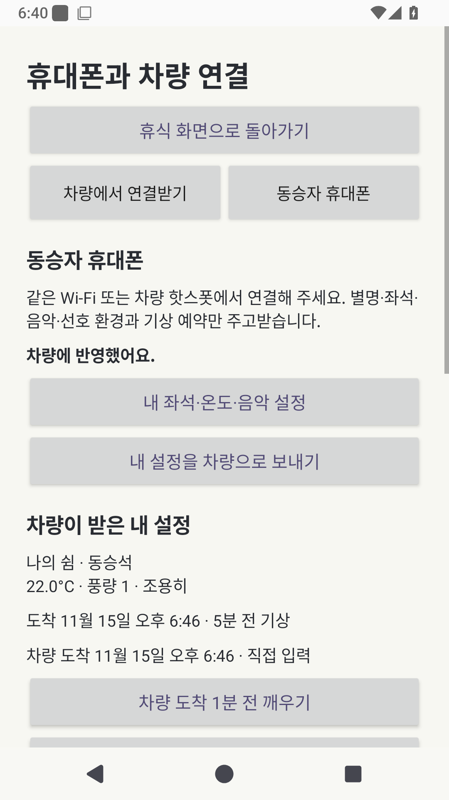

# 도착 전 기상과 동승자 휴대폰 연결

1.3.0은 동일 APK를 차량과 동승자 휴대폰에 설치해 사용하는 LAN 연결을 제공한다. 차량·휴대폰 계정이나 클라우드 중계 서버는 없다. 실제 차량의 Wi-Fi 정책, 핫스폿 격리, Pleos 설치·권한 정책에 따라 연결이 제한될 수 있다.

실제 Android 15 APK 화면이며 검사 전용 기준 차량 서버에 연결한 모습이다. 실차 연결 결과로 표현하지 않는다.

## 사용 순서

1. 출발 전에 차량과 휴대폰을 서로 통신할 수 있는 같은 Wi-Fi 또는 핫스폿에 연결한다.
2. 차량의 `휴대폰과 차량 연결 > 차량에서 연결받기 > 휴대폰 연결받기`를 연다.
3. 휴대폰에서 `휴대폰과 차량 연결 > 동승자 휴대폰 > 차량 주소로 연결`을 열고 차량에 표시된 IPv4 주소와 포트를 입력한다.
4. 양쪽의 인증 코드가 같은지 비교한 다음 휴대폰에서 6자리 연결 코드를 입력한다. 차량에서 별명을 확인해 연결을 승인한다.
5. 휴대폰의 `내 좌석·온도·음악 설정`에서 선호를 정하고 연결 화면의 `내 설정을 차량으로 보내기`를 누른다. 이 동작은 선호 전달이며 차량 공조 쓰기 요청이 아니다.
6. 차량에서 도착 예상 시각을 직접 설정하거나 `내비게이션 도착 연동`을 명시적으로 켠다. 휴대폰에서 차량 도착 1·5·10·15분 전 기상을 선택한다. 일반 휴식 시간 기준도 사용할 수 있다.
7. 휴대폰 알림을 허용하고 `동승자 휴식 시작`을 누른다. 각 휴대폰이 자신의 기상 알림을 예약한다. 정확한 알람 권한을 허용하면 절전 중 정확한 예약에 사용한다.
8. 차량에서 음악 제어를 맡긴 동승자만 차량 음악을 재생·일시정지·다음 곡·중지할 수 있다. 이미 다른 휴식이 진행 중이면 덮어쓰지 않는다.
9. 휴식 종료 후 느낌을 보내고 다음 설정 추천을 확인한다. 추천은 사용자가 적용해야 선호에 저장된다.

## 기상 예약

직접 입력한 도착 시각에서 개인 여유 시간을 뺀 시각을 사용한다. 이미 지난 기상이나 3시간을 넘는 새 예약은 거절한다. 자정을 지나는 시각은 다음 날로 계산한다. 도착 기준 세션에서는 5분 연장 대신 도착 시각을 변경한다.

차량의 시각과 휴대폰의 시각이 달라도 서버의 현재 시각과 종료 시각의 차이로 휴대폰 알람을 예약한다. 실제 알람은 `ELAPSED_REALTIME_WAKEUP`으로 동작한다. 도착 시각 변경은 연결 중 폴링으로 전달되므로 보통 5초와 통신 시간 정도의 지연이 있다. 연결이 끊기면 마지막 예약을 유지한다. 사용자가 예약을 해제하면 같은 세션의 폴링으로 다시 생성하지 않는다.

개인 기상 채널은 소리 없이 진동을 요청한다. 진동 하드웨어·채널 설정·방해 금지·알림 권한에 따라 실제 전달이 달라진다. 이 기능은 의료용 알람이 아니다. 재부팅·앱 강제 중지 후에는 자동 알림을 보장하지 않으며, 앱을 다시 열어 저장된 예약을 복구해야 한다.

일반 차량 타이머와 개인 휴대폰 기상은 구분한다. 차량 스피커로 동승자 전원의 기상음을 강제 재생하지 않는다. 한 휴대폰에는 현재 개인 기상 예약 하나를 유지한다.

## Pleos 내비게이션 연동

공개 `ai.pleos.playground:NaviHelper:3.0.5`와 `pleos.car.permission.NAVI_ROUTE`를 사용한다. 활성 경로 상태를 확인하고 `DestinationInfo.remainTime` 또는 `DrivingInfo.destination.duration`의 **초 단위 남은 시간**으로 ETA를 계산한다. 15초 간격 조회와 SDK 이벤트를 사용한다.

내비게이션 주소·좌표를 기록하거나 휴대폰에 보내지 않는다. 경로를 생성·변경·취소하지 않으며 GPS 권한도 요청하지 않는다. 연동은 차량에서 사용자가 명시적으로 시작하고 연결 서비스 종료 시 해제한다. 길안내가 없거나 권한·서비스가 실패하면 마지막 예약을 유지하고 직접 입력을 제공한다. 갑자기 ETA가 짧아져 여유 시간 안으로 들어오면 가능한 다음 동기화에서 바로 기상을 예약한다.

SDK 어댑터 구현과 빌드는 완료했다. **실차 및 실제 활성 경로의 ETA 수신·갱신 성공은 아직 검증하지 못했다.** 에뮬레이터의 기본 서비스 오류를 실제 내비게이션 연동 성공으로 간주하지 않는다.

## 여러 동승자와 피드백

차량 한 대에 최대 3개 휴대폰을 승인한다. 동승석·뒷좌석 왼쪽·오른쪽을 구분하며 중복 좌석과 운전석 요청은 허용하지 않는다. 휴식 시간과 기상 상태는 동승자별로 유지한다. 온도 요청은 좌석별로 표시한다.

공용 환경 제안은 가장 약한 요청 풍량을 고르고, 소리나 첫 곡이 다르면 무음을 제안한다. 제안을 확인해 선호에 저장할 수 있다. 실제 독립 공조·개별 스피커 지원을 가정하지 않으며 자동으로 차량에 쓰지 않는다.

추웠다는 평가에는 +0.5°C, 더웠다는 평가에는 -0.5°C를 16~30°C 안에서 제안한다. 소리가 거슬렸다는 평가에는 무음을 제안한다. 자세 불편에는 다음 휴식 전 자세 점검을 안내한다. 수면 단계 추정이나 학습형 AI가 아닌 명시적인 규칙이며, 자동 환경 변경 없이 사용자 확인을 거친다.

## 연결과 보안

- 사설 숫자 IPv4와 1024~65535 포트만 받는다. 기본 포트는 44389다. 공용 IP·DNS·HTTP URL은 받지 않는다. 테스트용 loopback도 허용한다.
- TLS 1.2와 ECDHE-RSA AES-GCM을 사용한다. 차량 개인키는 Android Keystore에 생성하며 내보내지 않는다.
- 첫 인증서 탐색은 지문 확인만 하고 별명·연결 코드·자격증명을 보내지 않는다. 사용자가 양쪽의 짧은 지문을 비교한 이후 모든 요청에서 전체 SHA-256 인증서 지문을 고정한다.
- 연결 코드는 2분 만료·오입력 5회 제한이며, 차량의 추가 승인이 필요하다. 승인 후 256비트 무작위 토큰을 사용한다. 차량에는 토큰 해시, 휴대폰에는 Keystore AES-GCM으로 암호화한 토큰을 보관한다.
- 프레임 최대 32KB, 소켓·작업 수·연결/읽기 대기 시간에 상한을 둔다. 모든 상태 변경은 앱 메인 스레드에서 처리한다.
- `connectedDevice` foreground service와 종료할 수 있는 연결 알림을 제공한다. 사용 휴대폰이 없는 차량 서버는 만료 후 종료한다. 부팅 시 자동으로 서버를 열지 않는다.
- 별명·좌석·선호 온도/풍량·음악 목록·기상 상태·평가는 승인한 차량과 교환한다. 마이크·통화·연락처는 수집하지 않는다. 백업은 비활성화했다.

차량 화면 제한은 유지한다. 연결 기능이나 동승자 역할로 제한된 차량 화면을 우회하지 않는다. 휴대폰 요청으로 주행 중 HVAC 또는 좌석 모터를 직접 제어하는 API는 제공하지 않는다.

## 공식 자료

- [Pleos NaviHelper 시작](https://document.pleos.ai/en/docs/pleos-only/connect-sdk-pleos/NaviHelper/importing-sdk)
- [Android 연결 기기 foreground service](https://developer.android.com/develop/background-work/services/fgs/service-types#connected-device)
- [Android 정확한 알람](https://developer.android.com/develop/background-work/services/alarms/schedule)
- [Android TLS 서버용 Keystore 키 설정](https://developer.android.com/reference/android/security/keystore/KeyGenParameterSpec.Builder)

실행으로 확인한 항목과 남은 제약은 [검증 기록](VERIFICATION.md)을 따른다.
