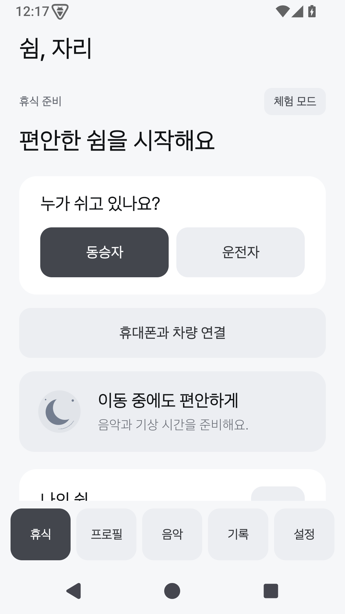
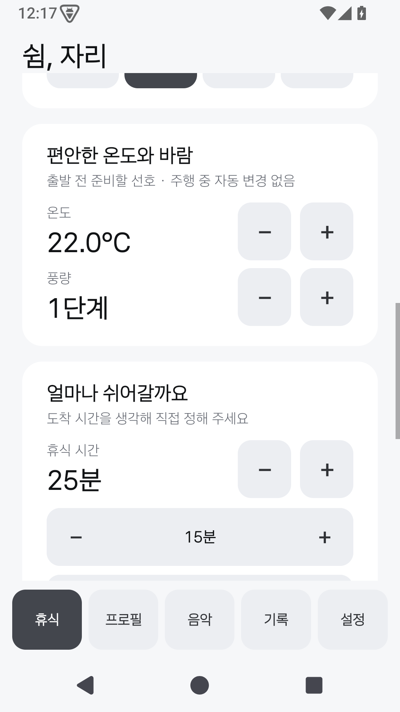
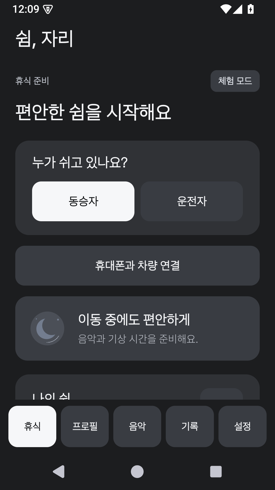
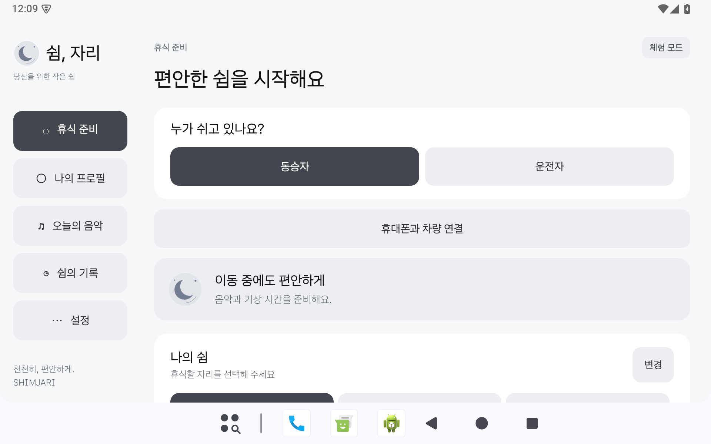

# 쉼, 자리 화면 구성

1.3.1은 Pleos Connect의 공식 색상·타이포그래피 가이드를 참고해 앱의 화면을 정리한 버전이다. 앱 이름은 **쉼, 자리**로 표시하며 기존 패키지와 서명을 유지해 업데이트할 수 있다.

## 색상과 글꼴

| 용도 | 라이트 | 다크 |
| --- | --- | --- |
| 화면 배경 | `#F6F7F9` | `#1C1D1F` |
| 카드 | `#FFFFFF` | `#303236` |
| 주요 글자 | `#111315` | `#F6F7F9` |
| 보조 글자 | `#62666F` | `#BCC0C8` |

시스템의 라이트·다크 설정을 따른다. 조도 센서를 별도로 읽지 않는다. 제목·본문·버튼에는 Asta Sans를 포함해 사용하며 SIL Open Font License 원문은 `app/src/main/assets/fonts/OFL-AstaSans.txt`에 보관한다. 설정·연결·휴식 화면의 글꼴과 버튼 높이, 눌림·선택·비활성 상태를 공통으로 적용한다.

## 간결한 선택과 시간 조절

- ‘누가 쉬고 있나요?’에는 **동승자 / 운전자** 두 항목만 표시한다.
- 총 휴식 시간 옆의 −/+는 **1분 단위**로 조절한다.
- 별도 **− 15분 +**, **− 1시간 +**로 빠르게 증감한다. 기존 15·25·40분 프리셋은 제거했다.
- 휴식 시간 범위는 1~180분이다. 도착 전 기상 예약이 설정되어 있으면 해당 예약이 우선한다.
- 같은 화면에서 시간·온도·풍량·소리·기상 설정을 바꿀 때 현재 스크롤을 유지한다. 다른 메뉴나 휴식 단계로 이동할 때는 새 화면을 표시한다.

카드와 버튼의 왼쪽 기준선, 숫자와 증감 버튼의 위치를 맞췄다. 좁은 화면에서는 긴 선택 항목을 두 열로 배치하고, 글꼴 크기를 키워도 고정 높이에 잘리지 않도록 했다.

## 실행 화면

다음은 Android 15 휴대폰 에뮬레이터에서 실행한 실제 APK 화면이다. 차량 공조 값은 체험 값이며 실차 화면 검증 결과로 표현하지 않는다.

360dp·411dp 휴대폰, 320dp와 글꼴 배율 1.3 조합, 960dp 가로 배치에서 확인했다. 시간 증감과 개인 기상 예약 해제 전후에 버튼의 화면 좌표가 유지되는지도 확인했다.

## 참고 자료

- [Pleos Connect 색상 가이드](https://document.pleos.ai/docs/connect/guide/docs-design/foundations/colors)
- [Pleos Connect 타이포그래피](https://document.pleos.ai/docs/connect/guide/docs-design/foundations/typography)
- [Pleos Connect 기본 버튼](https://document.pleos.ai/docs/connect/guide/docs-design/components/actions/basic-button)
- [Asta Sans 원본 프로젝트](https://github.com/42dot/Asta-Sans)
